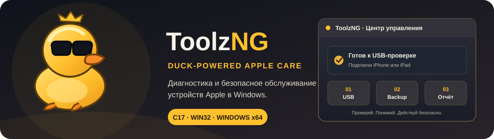
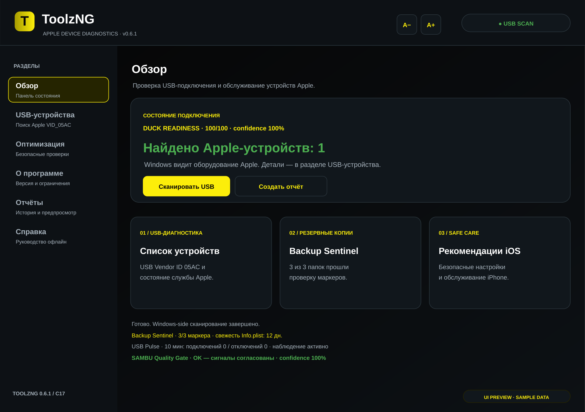
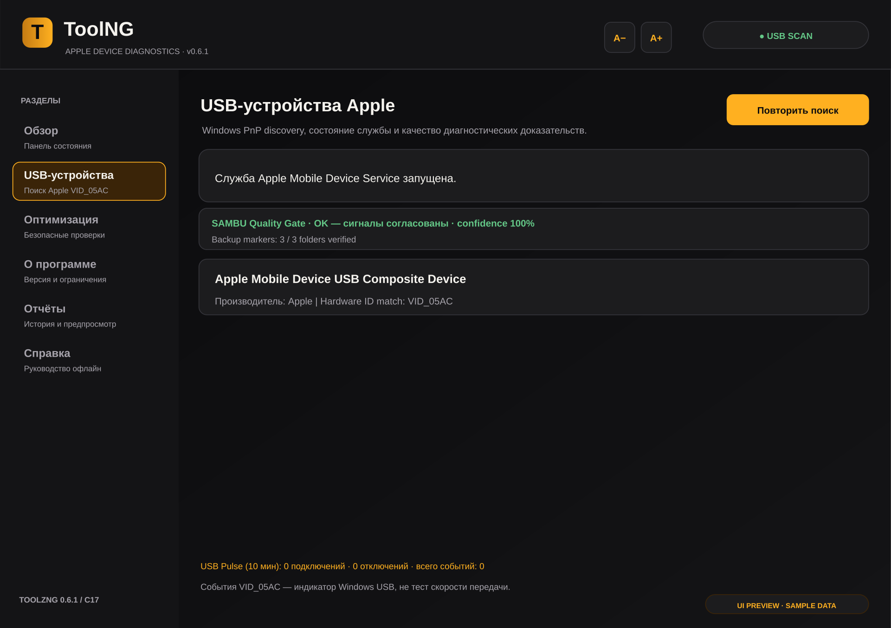
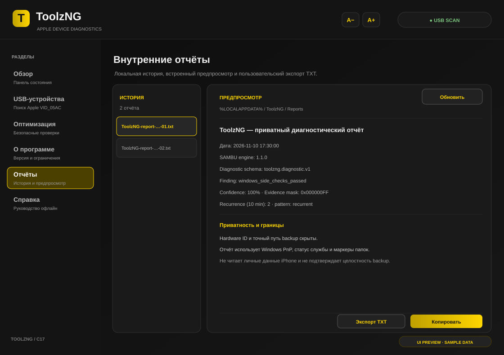
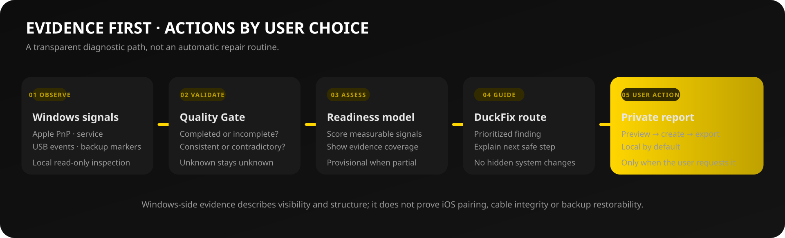

# WDEC — Windows Device Evidence Console

### Local USB diagnostics · service state · backup-structure audit

**Observe. Correlate. Explain.**

WDEC is a native C17/Win32 Windows utility. It inspects operating-system-visible mobile-device connection signals, USB events, related service state, and structural markers in local backup directories. It does not modify a device or upload diagnostic data.

[Українська](README.md) · [English](README.en.md) · [Русский](README.ru.md)

---

## Purpose

Connection issues can originate at different Windows layers: a device may be missing from Plug and Play, a related service may be unavailable, USB connectivity may be unstable, or a local backup may lack expected structural markers. WDEC separates these observations instead of collapsing them into a single connected/disconnected flag.

It is an **evidence-oriented diagnostic console**, not a firmware repair tool, backup manager, or monitor of a mobile operating system's internal health.

## Interface

> Screens are static SVG mockups with sample values. They are not captures from a live scan or real device data.

## Evidence model

| Confirmed signal | Maximum contribution |
|---|---:|
| Scan completed and USB device interface is visible | 40 |
| Related service state was confirmed | 25 |
| Local backup root was found | 10 |
| Discovered backup directories contain expected structural markers | 15 |
| Observation window completed, watcher active, no removals observed | 10 |
| **Total** | **100** |

The score is normalized over the weights that could actually be measured. **Evidence coverage** reports how much of the model was available for inspection. A perfect score with partial coverage remains provisional.

The Quality Gate distinguishes:
- **Observed** — inspection completed and the signal was confirmed.
- **Not found** — inspection completed and the expected signal was absent.
- **Unknown** — access failed, enumeration was incomplete, or the observation window did not finish.

A service-manager query failure does not prove that a service is stopped. An incomplete backup scan does not prove that no backup exists. An inactive watcher cannot confirm USB stability.

## Architecture

| Layer | Implementation |
|---|---|
| Desktop UI | C17 · Win32 API · GDI |
| Device discovery | Windows SetupAPI / Plug and Play |
| Service state | Windows Service Control Manager |
| USB events | Windows device notifications |
| Diagnostic core | Portable C17 policy core and bounded workflow |
| Reports | Local TXT · SHA-256 sidecar |
| Build | CMake 3.20+ |

The core owns deterministic assessment, permissions, evidence quality, and bounded finding memory. Windows APIs are isolated at the platform layer. The workflow DSL invokes a fixed allowlist of actions; it is not a general-purpose interpreter, shell, or scripting language.

## Build

**Windows x64:** Windows 10/11, Visual Studio 2022 or compatible MSVC Build Tools with Desktop development with C++, CMake 3.20+.

~~~powershell
cmake -S . -B build -A x64 -DBUILD_TESTING=ON
cmake --build build --config Release --parallel
ctest --test-dir build -C Release --output-on-failure
~~~

Executable after the build-target migration: build\Release\WDEC.exe. The desktop interface is Windows-only. A successful core build does not validate a driver, pairing session, specific device, or physical cable.

## Privacy and boundaries

- No account, telemetry, or cloud upload is required.
- Backup contents are not read; only structural markers and metadata are inspected.
- Private report mode hides hardware identifiers and full paths.
- Report creation, copying, and export require explicit user action.
- Logs and report history have fixed storage bounds.
- Normal operation does not require administrator privileges.

A USB vendor ID alone does not confirm pairing; structural markers do not prove backup integrity or restorability; one file timestamp does not describe the age of all backup data; FNV-1a is not a cryptographic identity; a SHA-256 sidecar does not prove report truthfulness.

WDEC does not jailbreak, bypass a passcode or activation lock, flash or reset a device, read personal device data, automatically repair drivers, or measure cable electrical properties, USB throughput, battery condition, or mobile-OS temperature.

## Keyboard shortcuts

| Shortcut | Action |
|---|---|
| F5 | Repeat USB scan |
| Ctrl+R | Create a local report |
| F1 | Open help |
| Ctrl++ / Ctrl+- | Change zoom |
| Ctrl+0 | Reset zoom to 100% |

Per-Monitor DPI v2 and 80–160% zoom are supported. Full UI Automation support and complete keyboard navigation remain development items.

## Roadmap

1. Split UI composition, report generation, and event routing into independent C modules.
2. Add an optional adapter for a compatible pairing API with explicit user consent.
3. Show device model and OS version only when a trusted source provides them.
4. Extend USB-driver diagnostics without hidden system mutation.
5. Complete localization, accessibility, installer, reproducible packaging, and hardware smoke tests.

## Engineering standards

- [Design Rules](docs/DUCK_DESIGN_RULES.md) — evidence, privacy, and limits.
- [Core Integration](docs/SAMBU_INTEGRATION.md) — assessment and bounded workflow.
- [Quality Gates](docs/ENGINEERING_QUALITY_GATES.md) — tests and release criteria.
- [Build](docs/BUILDING.md) · [Safety Model](docs/SAFETY_AND_SCOPE.md).

## License

MIT — see [LICENSE](LICENSE).
