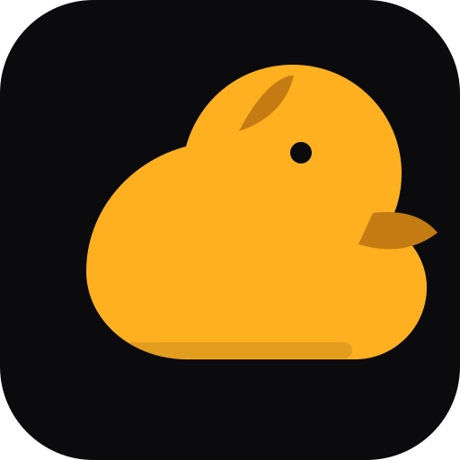

<p align="center"></p>
<h1 align="center">ToolNG</h1>
<p align="center"><strong>Windows Device Evidence Probe</strong></p>
<p align="center"></p>
<p align="center"><a href="README.md">🇺🇦 Українська</a> · <a href="README.en.md">🇬🇧 English</a> · <a href="README.ru.md">🇷🇺 Русский</a></p>

> **ToolNG** — ToolNG — локальний read-only інструмент діагностики Windows, який відокремлює підтверджені сигнали від невідомого стану та неповного покриття.

## Поточні можливості
- Огляд доступних Windows PnP/USB-пристроїв та пов'язаних служб.
- Read-only перевірка локальних маркерів резервного копіювання.
- Спостереження за подіями підключення/відключення, локальні звіти й журнали.
- Пояснювана оцінка готовності з окремим показником повноти доказів.
- Редагування чутливих полів і рекомендації оператору.

## Швидкий старт і перевірка
```bash
cmake -S . -B build
cmake --build build --config Release
python one.py check
```

## Архітектура, межі та достовірність
ToolNG не ремонтує пристрої, не змінює драйвери чи служби, не читає приватний вміст backup і не відправляє діагностику в хмару. Рекомендація не означає виконану дію.

## Інженерна якість
- Перевіряйте збірку й тести саме для цільової платформи; host CI не замінює hardware qualification.
- Статуси **implemented**, **partial**, **planned** мають підтверджуватися кодом, тестами та документацією.
- Не оголошуйте функцію production-ready лише на підставі макета, специфікації чи відкритого Pull Request.
- Зовнішні інтеграції мають бути явними, версіонованими, ізольованими й перевірюваними.

## NUN Mesh та пов'язані репозиторії
[SAMBU](https://github.com/bboroski/SAMBU) · [ToolNG](https://github.com/bboroski/ToolNG) · [ReaperCripple](https://github.com/bboroski/ReaperCripple) · [Kloz](https://github.com/bboroski/Kloz) · [CO](https://github.com/bboroski/CO) · [SaintSI](https://github.com/bboroski/SaintSI) · [Klipot](https://github.com/bboroski/Klipot) · [NUN](https://github.com/bboroski/NUN) · [NUNLauncher](https://github.com/bboroski/NUNLauncher) · [Fragile-Baby](https://github.com/bboroski/Fragile-Baby) · [Luci](https://github.com/bboroski/Luci)

Репозиторії зберігають власні назви, код, API, цикли випуску та межі відповідальності. Інтеграція означає узгоджені контракти, а не автоматичне злиття незалежних runtime.

## Дизайн і документація
Базовий інтерфейсний напрям екосистеми — **Duck Black / Yellow**: чорні поверхні, жовтий акцент для дій і станів, читабельна типографіка, доступний контраст, клавіатурна навігація та підтримка reduced motion. Деталі дивіться в [design/DUCK_UI_SYSTEM.md](design/DUCK_UI_SYSTEM.md), якщо файл присутній у цьому репозиторії.

## Ліцензія
MIT

---
**Створено з любов'ю до інженерії, системності та людей.**


## Інтерфейсний стандарт і внесок

Візуальна система та межі GUI: [GUI Design Standard](docs/gui/GUI_DESIGN_STANDARD.md) і [Duck UI system](design/DUCK_UI_SYSTEM.md). Значення статусу/прогресу в макетах є умовними, доки їх не підключено до реальних вимірювань. Шаблон перевірки змін: [.github/PULL_REQUEST_TEMPLATE.md](.github/PULL_REQUEST_TEMPLATE.md). Для злиття потрібні два незалежні схвалення та всі обов'язкові перевірки CI; примусове застосування залежить від налаштувань захисту гілки.
