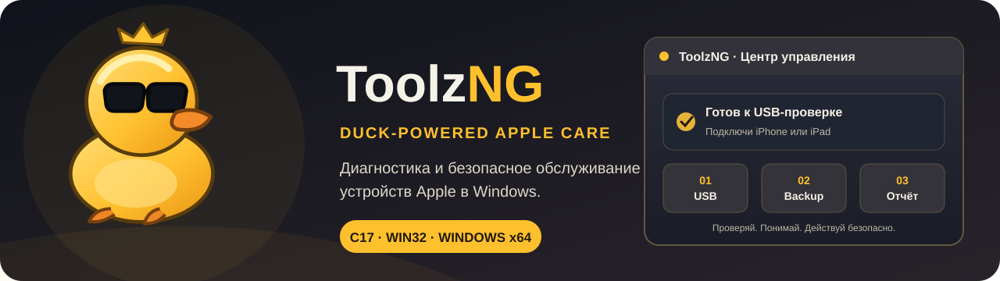
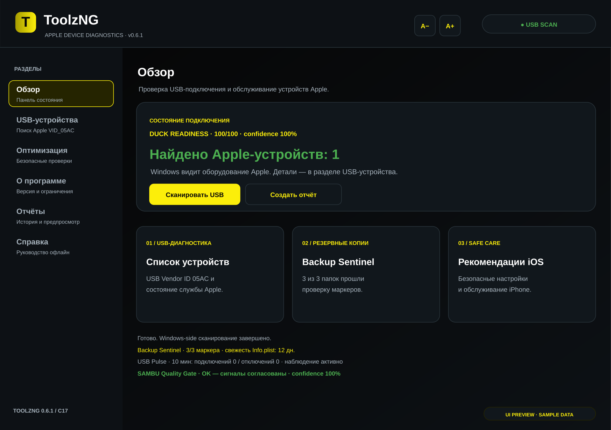
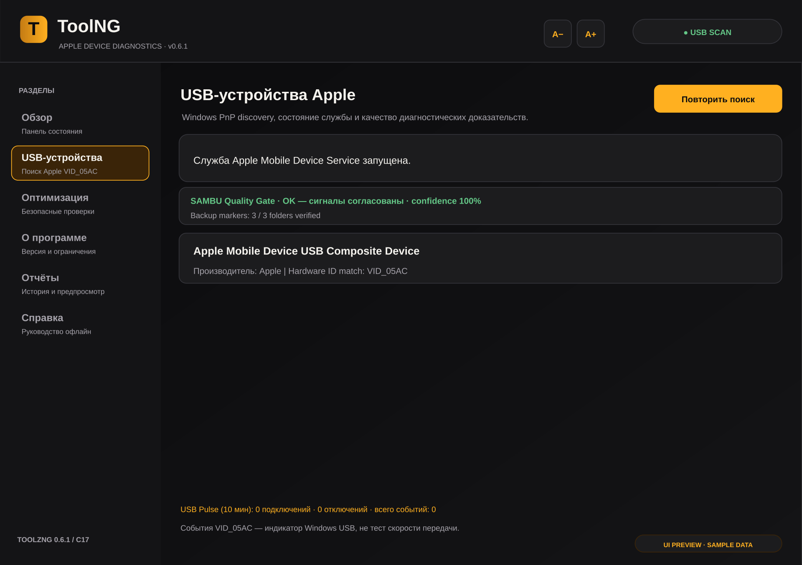
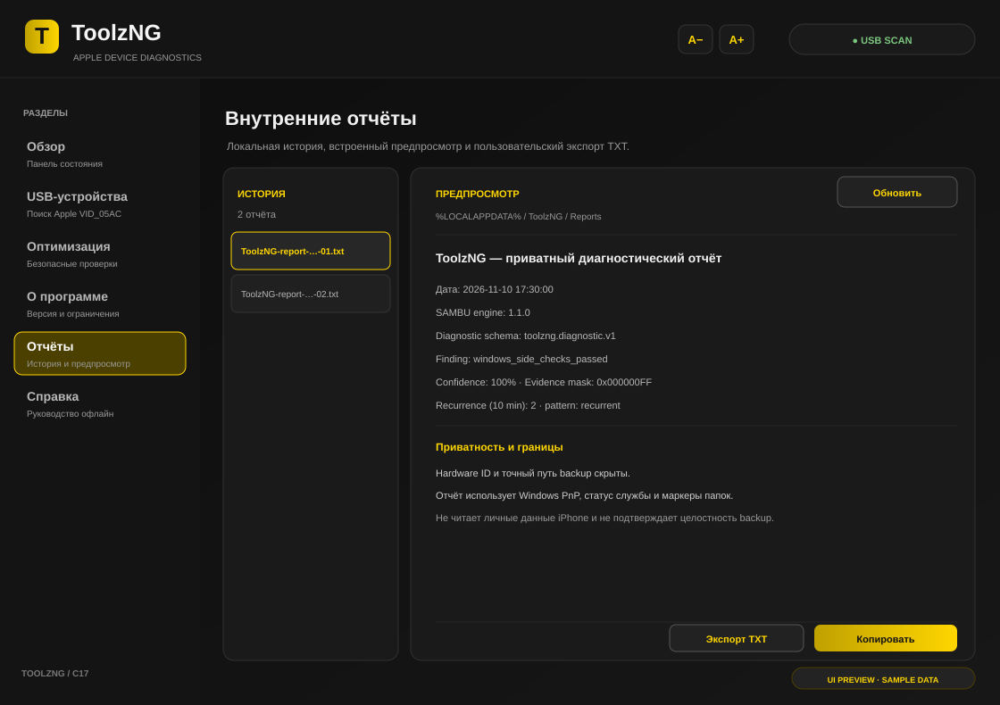

<div align="center">

  

  <br />
  
  
  
  
  
  <a href="https://github.com/bboroski/ToolNG/actions/workflows/windows-ci.yml"></a>

  **Проверяй. Понимай. Действуй безопасно.**

<p align="center">
  
</p>

## 🟡 Возможности версии 0.6.1 — Duck Desktop Experience
## 🟡 Возможности версии 0.6.1 — ToolzNG Desktop + SAMBU Engine 1.2.0

| Раздел | Что умеет утка |
|---|---|
| 🦆 USB-диагностика | Ищет видимые Windows Plug and Play интерфейсы Apple по USB Vendor ID `05AC` и проверяет службу Apple Mobile Device Service. |
| 🧭 Duck Readiness Score | Объяснимая оценка от 0 до 100 нормируется только по проверенным сигналам Windows. Непрочитанная служба, недоступный каталог backup или незавершённое USB-наблюдение не превращаются в ложный ноль: рядом показывается покрытие измерениями и provisional/complete статус. Это не бенчмарк iPhone. |
| 🔁 Recurrence Radar | SAMBU отличает единичный сбой от повторяющегося и устойчивого цикла: учитывает только переходы между диагностическими состояниями, хранит ограниченное окно 10 минут и не считает повторные перерисовки новыми событиями. |
| 📡 USB Pulse | Отслеживает события подключения/отключения Apple USB через Windows device notifications и хранит последние события. Показывает события за 10 минут. |
| 🛡️ Backup Sentinel | Read-only проверяет наличие `Info.plist` и `Manifest.db`/`Manifest.plist` в папках backup. Не читает личное содержимое файлов. |
| 🔐 Privacy Shield | Отчёты создаются приватными по умолчанию: Hardware ID и точный путь к backup исключены. Предпросмотр открыт внутри приложения. |
| 🧰 DuckFix | Подбирает следующий безопасный шаг по наблюдаемым проблемам: кабель/доверие, компонент Apple, нестабильный USB, структура копии или создание backup. Ничего не исправляет без пользователя. |
| 🎨 Duck UI | Нативный Win32/GDI-интерфейс на C17 с графитово-чёрной и жёлтой системой цветов. |
| 🧬 LinkDNA | Создаёт локальный FNV-1a отпечаток набора Windows-visible Apple Hardware IDs, производителя и состояния службы. Сохраняет только хэш-профиль и сравнивает его при следующих запусках; это не серийный номер и не криптографическая идентичность. |
| 🗃️ PulseVault | Сохраняет события Apple USB в локальный JSONL-журнал в %LOCALAPPDATA%\ToolzNG\usb-pulse.jsonl; при превышении 256 КБ ротирует предыдущий журнал в .old. Серийные номера и файлы устройства не записываются. |
| ⏳ Backup Freshness Radar | Показывает возраст самого свежего Info.plist по времени изменения. Это ориентир свежести метаданных, а не проверка содержимого или восстановимости резервной копии. |
| 🧭 DuckFix Route Export | Экспортирует персональный пошаговый маршрут диагностики в TXT с сигналами, рекомендациями и безопасным порядком действий. Ничего не исправляет автоматически. |
| 🔏 Evidence Seal | К внутреннему TXT-отчёту добавляется SHA-256 sidecar для обнаружения последующего изменения файла. |

| 🖥️ DPI + Zoom | Per-Monitor DPI v2, реакция на смену монитора, кнопки A−/A+ и Ctrl +/-/0. Пользовательский zoom 80–160% сохраняется между запусками. |
| 📑 Внутренние отчёты | Локальная история до 32 диагностических TXT-файлов в %LOCALAPPDATA%\\ToolzNG\\Reports, просмотр и прокрутка внутри окна, копирование и необязательный экспорт TXT. |
| 📚 Offline Help | Справка, раздел «О программе» и отчёты доступны в нативной навигации; F1 открывает локальное руководство. Рутинные действия не запускают браузер. |
| 🎨 Yellow Graphite | Токены интерфейса: #0D0D0D, #FFD600, #BFA100, #E6E6E6 и #999999; жёлтый оставлен для приоритетных действий и состояния. |

ToolzNG объединяет пять исходных функций Duck Intelligence и пять новых локальных модулей 0.5.0 и ядро SAMBU 1.1 в одном лёгком C/Win32-приложении. Их отличие — связанная последовательность: профиль связи → история событий → свежесть маркеров backup → объяснимый маршрут исправления → отчёт с контрольной суммой.
ToolzNG связывает Windows PnP-инвентаризацию, запрос состояния Apple-службы, проверку маркеров backup, USB event journal, evidence-aware readiness, локальную память повторов и приватный TXT-отчёт в один диагностический маршрут. Переносимое ядро SAMBU Engine 1.2.0 отделено в C17-модуль; Win32/GDI остаётся платформенным UI-слоем.

Мы не обещаем, что аналогов нигде не существует: у крупных iPhone-менеджеров уже есть диагностика, backup и журналы. Уникальность здесь — авторская композиция этих небольших локальных механизмов с приватностью по умолчанию, а не неподтверждённое заявление «первое в мире».

## 🪟 GUI Design — progressive disclosure

ToolzNG uses a practical overview → detail → action flow: the dashboard stays concise, USB and backup pages reveal evidence, and reports/help provide deeper review. This is the implementation behind the project’s “Curtain Dynamics” metaphor; it is contextual navigation, not a claim of animated curtains, a workflow editor or terminal emulator. See [GUI Design and visual evidence](docs/GUI_DESIGN.md).

## 🧬 SAMBU Core 1.1 — инженерная система пяти букв

В версии **0.6.1** в ToolzNG перенесены инженерные принципы репозитория [SAMBU](https://github.com/bboroski/SAMBU), адаптированные к нативному C17/Win32-приложению. Python-интерпретатор SAMBU не встраивается.
В текущей ветке в ToolzNG перенесены инженерные принципы репозитория [SAMBU](https://github.com/bboroski/SAMBU), адаптированные к нативному C17/Win32-приложению. Python-интерпретатор SAMBU не встраивается.

| Буква | Закон SAMBU | Реализация в ToolzNG |
|---|---|---|
| **S — Safety** | Ограничение полномочий | Fail-closed политика действий: чтение и сканирование разрешены; создание отчёта, буфер обмена и экспорт требуют явного действия пользователя; изменение iOS и сетевая выгрузка запрещены ядром. |
| **A — Adaptive** | Исследование по доказательствам | Детерминированный движок выбирает приоритетную рекомендацию DuckFix из наблюдаемых сигналов Windows. Это набор проверяемых правил, не машинное обучение. |
| **M — Managed** | Управляемая память и восстановление | Ограниченный журнал на 32 уникальных кода состояния: счётчики повторов и монотонные отметки времени без Hardware ID, путей backup и содержимого устройства. |
| **B — Branchable** | Слоистая, ветвящаяся архитектура | Ядро вынесено в `src/sambu_engine.c/.h` и `src/sambu_workflow.c/.h`; граф зависимостей проверяется до создания окна. UI и экспорт являются независимыми ветвями над общими результатами диагностики. |
| **U — Unforced** | Совместимость и свобода пользователя | Стабильные коды результатов, версия движка и контракт отчёта `toolzng.diagnostic.v1`; экспорт остаётся локальным и инициируется пользователем. |

### Применение всех десяти артикуляционных семейств SAMBU

| Буква | Семантика SAMBU | Инженерное применение |
|---|---|---|
| **K** | Структура | Отдельное ядро и граф модулей |
| **T** | Поток | Порядок диагностических проверок и выбор следующего шага |
| **R** | Значения | Типизированные поля наблюдений и числовые ограничения |
| **M** | Память | Дедуплицированный журнал состояний |
| **S** | Защита | Политика разрешений и запрет опасных действий |
| **V** | Измерение | Duck Readiness, покрытие измерениями, разложение балла и битовая маска подтверждённых сигналов |
| **D** | Доказательства | Стабильные коды результатов, версия схемы и SHA-256 отчёта |
| **N** | Координация | События USB и локальный PulseVault |
| **P** | Преобразование | Явное формирование локального отчёта и пользовательский экспорт |
| **L** | Язык | Независимость машинных кодов диагностики от текста интерфейса |

Пять гласных SAMBU описывают жизненный цикл проверки: **A** — начать сканирование, **E** — осмотреть сигналы, **I** — вычислить показатели, **O** — собрать единый вывод, **U** — завершить отчёт. Четыре грамматические роли артикуляционной системы перенесены в контракт API: действие, сущность, связь и состояние.

### Проверка ядра

CTest проверяет политику доступа, оценку готовности, приоритеты диагностики, ограниченный журнал, граф зависимостей, а также лексер, парсер, source-span, preflight и пошаговый запуск SAMBU Workflow.

```powershell
cmake -S . -B build -A x64
cmake --build build --config Release --parallel
ctest --test-dir build -C Release --output-on-failure
```

---

### SAMBU Workflow 1.1 — декларативные диагностические сценарии

ToolzNG компилирует встроенный сценарий в ограниченный AST с координатами исходника. Пример из [`workflows/apple_connection.sambu`](workflows/apple_connection.sambu):

```sambu
workflow apple_connection {
  manifest {
    purpose "Windows-side Apple connection audit";
    max_steps 5;
    autonomy local_record;
  }

  step usb = observe.apple_usb;
  step service = observe.apple_service;
  step profile = record.link_profile;
  step backup = observe.backup_markers;
  step readiness = compute.readiness;
}
```

Перед запуском проверяются манифест задачи, лимит шагов, allowlist операций и два уровня допуска: workflow preflight и SAMBU capability gate. За один WM_TIMER tick выполняется максимум один шаг. Результаты, source-span и ошибки попадают в bounded evidence ledger и добавляются в локальный TXT-отчёт.

| Возможность из SAMBU | Статус именно в ToolzNG |
|---|---|
| Lexer, parser, source-aware AST | **Implemented · restricted workflow DSL** |
| Task manifest, bounded autonomy, preflight, evidence ledger | **Implemented · fixed local diagnostic actions** |
| Cooperative step scheduler | **Implemented · one action per Win32 timer tick; same UI thread** |
| Local profile dual gate | **Implemented · policy + workflow preflight; no HSM** |
| General functions, scopes, branches, loops, arrays, records | **Not ported · no general-purpose language runtime** |
| OOP, interfaces, traits and game-state helpers | **Not applicable to this Apple diagnostics build** |
| Actors, supervision, generic channels, OS threads, native fibers | **Not implemented** |
| Python generator scheduler and resource scopes | **Not embedded in native C** |
| SI/scientific helpers, voxel worlds, graph/mesh engine | **Not integrated into this product** |
| Judo/Aikido/Jiu-Jitsu, Magento inspector, scaffold generator | **Not integrated; separate SAMBU host modules** |
| Native compiler, self-hosting, static ownership/effect checker, IDE/LSP | **Planned in the language/toolchain, not claimed here** |

This is intentionally not a general-purpose SAMBU interpreter. The DSL has no arbitrary shell, filesystem, network, device-mutation, user-defined function, loop or conditional syntax. It invokes only the five actions listed in `src/sambu_workflow.c`. The cooperative dispatcher is not a fiber or multithreaded scheduler.

## 🧪 Границы измерений
## ToolzNG — когда нужно знать, а не гадать

Подключение iPhone к Windows иногда превращается в квест: устройство не отображается, служба Apple недоступна, USB-соединение периодически пропадает, а папка резервной копии выглядит подозрительно.

- **Duck Readiness** оценивает готовность Windows-side подключения, а не скорость, температуру, здоровье батареи или состояние процессов iOS.
- **USB Pulse** считает события интерфейсов, путь которых содержит `VID_05AC`; это не тест пропускной способности и не электрическая диагностика кабеля.
- **Backup Sentinel** проверяет только ожидаемые имена marker-файлов. Он не доказывает целостность базы, полноту данных, корректность шифрования или возможность восстановления.
- **Privacy Shield** скрывает Hardware ID и полный локальный путь в приватном режиме. Перед отправкой отчёта всё равно следует просмотреть его содержимое.
- **DuckFix** предлагает инструкции, но не меняет настройки iPhone, не перезапускает службы и не удаляет файлы автоматически.
- **Evidence coverage** показывает долю весов, для которых есть завершённое измерение; значение 100% означает полный набор проверок, а не вероятность исправности. При меньшем покрытии оценка помечается provisional.
- **Unknown ≠ failed:** отказ доступа к Service Control Manager, неполный обход backup-каталога или незавершённое окно USB-наблюдения дают отдельные состояния «не проверено», а не «служба остановлена», «backup отсутствует» или «кабель нестабилен».

Это не «ускоритель iPhone» и не магическая кнопка ремонта. Это компактная инженерная панель на C17 и Win32 API: без Electron, без обязательного аккаунта, без облачной отправки диагностических данных.

## Что ToolzNG умеет

| Возможность | Польза |
|---|---|
| **Apple USB Discovery** | Находит присутствующие Windows PnP-интерфейсы Apple по Vendor ID 05AC и показывает доступность Apple Mobile Device Service. |
| **Duck Readiness** | Сводит проверяемые Windows-side сигналы в объяснимую оценку от 0 до 100. |
| **SAMBU Quality Gate** | Выявляет неполные и противоречивые данные, прежде чем они попадут в итоговую оценку. |
| **USB Pulse + Recurrence Radar** | Отслеживает подключения и отключения Apple USB и помогает отличать одиночный эпизод от повторяющегося сбоя. |
| **Backup Sentinel** | Read-only проверяет структурные маркеры локальных резервных копий, не открывая их личное содержимое. |
| **Backup Freshness** | Показывает возраст самого свежего Info.plist по времени изменения. |
| **DuckFix Guide** | Предлагает следующий безопасный шаг на основании приоритетного finding. |
| **LinkDNA** | Сравнивает локальный FNV-1a отпечаток набора Windows-visible сигналов Apple. |
| **PulseVault** | Ведёт ограниченный локальный JSONL-журнал USB-событий с ротацией. |
| **Privacy Shield + Evidence Seal** | Скрывает Hardware ID и полный путь backup в приватном отчёте; SHA-256 sidecar помогает заметить последующее изменение файла. |
| **Offline Reports & Help** | Даёт локальную историю до 32 отчётов, встроенный предпросмотр, копирование, TXT-экспорт и справку F1. |

## Посмотри на интерфейс

Ниже — обновлённые превью экранов ToolzNG 0.6.1. Они собраны по актуальной Win32/GDI-разметке и показывают новые состояния Quality Gate. **Это статические UI-превью с демонстрационными значениями, а не фотографии работающего приложения и не результаты реального сканирования.**

<p align="center">
  
  <strong>01 · Центр управления</strong><br />
  Duck Readiness, USB Pulse, Backup Sentinel и состояние качества диагностических сигналов.
</p>

<p align="center">
  
  <strong>02 · USB-устройства Apple</strong><br />
  Windows PnP discovery, состояние службы Apple, Quality Gate и покрытие backup-маркеров.
</p>

<p align="center">
  
  <strong>03 · Локальные отчёты</strong><br />
  Предпросмотр диагностического отчёта с readiness, evidence mask, quality flags и версией SAMBU.
</p>

## Почему это полезно

**Не просто «устройство найдено».** ToolzNG показывает отдельные уровни проверки: видит ли Windows Apple USB, доступна ли служба, что произошло с соединением за последние десять минут и какие маркеры найдены в локальных backup-каталогах.

**Не прячет сомнительные данные за красивым баллом.** SAMBU Quality Gate проверяет целостность входных сигналов. Если три папки резервных копий обнаружены, а маркеры подтверждены только в одной, программа не выдаёт частичную проверку за полную.

**Не забирает контроль у пользователя.** Приложение не исправляет систему тайком, не удаляет файлы и не загружает отчёты в облако. Оно объясняет состояние и предлагает следующий безопасный шаг.

## Duck Readiness — оценка с понятной математикой

Текущая модель использует следующие веса:

| Подтверждённый сигнал | Баллы |
|---|---:|
| Сканирование завершено и Apple USB-интерфейс виден | +40 |
| Apple Mobile Device Service запущена | +25 |
| Локальный каталог backup найден | +10 |
| Все обнаруженные папки прошли проверку ожидаемых маркеров | +15 |
| Устройство подтверждено, watcher активен, окно наблюдения завершено и отключений нет | +10 |
| **Максимум** | **100** |

### SAMBU Quality Gate

- Устройство не засчитывается без завершённого сканирования.
- Валидных backup-каталогов не может быть больше, чем просмотренных.
- Полный бонус за маркеры выдаётся только тогда, когда проверены все обнаруженные каталоги.
- Окно стабильности не считается доказательством, если USB watcher не был активен.
- Противоречия и неполные сигналы формируют integrity flags и снижают confidence.

| Integrity flag | Значение |
|---|---|
| <code>DEVICE_WITHOUT_SCAN</code> | Сигнал устройства есть, завершённого сканирования нет. |
| <code>BACKUP_COUNTS_INCONSISTENT</code> | Счётчики backup противоречат друг другу. |
| <code>BACKUP_SET_INCOMPLETE</code> | Не все найденные папки прошли проверку маркеров. |
| <code>STABILITY_WITHOUT_WATCH</code> | Окно наблюдения прошло без активного USB watcher. |

Confidence описывает полноту и согласованность локальной диагностики. Это не вероятность аппаратной исправности iPhone и не benchmark производительности.

## Быстрые клавиши

| Клавиша | Действие |
|---|---|
| <kbd>F5</kbd> | Повторить USB-сканирование |
| <kbd>Ctrl</kbd> + <kbd>R</kbd> | Создать локальный диагностический отчёт |
| <kbd>F1</kbd> | Открыть встроенную справку |
| <kbd>Ctrl</kbd> + <kbd>+</kbd> / <kbd>−</kbd> | Увеличить или уменьшить масштаб |
| <kbd>Ctrl</kbd> + <kbd>0</kbd> | Вернуть масштаб 100% |
| <kbd>A−</kbd> / <kbd>A+</kbd> | Изменить масштаб кнопками панели |

## Приватность и безопасность

ToolzNG проектируется по принципу local-first:

- локальное чтение и USB-сканирование доступны приложению;
- создание отчёта, экспорт и копирование требуют явного действия пользователя;
- изменение устройства и сетевая отправка данных запрещены политикой SAMBU;
- Backup Sentinel проверяет имена и атрибуты маркерных файлов, не читая payload резервной копии;
- приватный отчёт скрывает Hardware ID и полный путь backup;
- USB-журнал ограничен ротацией, история отчётов — 32 файла;
- LinkDNA хранит хэш-профиль, а не исходный Hardware ID;
- обычная работа не требует прав администратора.

**Честные границы:** видимый VID_05AC не доказывает pairing iOS; маркерные файлы не доказывают восстановимость backup; SHA-256 sidecar не доказывает правдивость самого отчёта.

ToolzNG не выполняет jailbreak, не обходит пароль или Activation Lock, не прошивает и не сбрасывает устройство, не читает личные данные и не разгоняет CPU/GPU iPhone.

## Нативная архитектура

| Слой | Технология |
|---|---|
| Desktop UI | C17 · Win32 API · GDI |
| Device discovery | Windows SetupAPI / PnP |
| Apple service check | Windows Service Control Manager |
| Device events | Windows device notifications |
| Diagnostic core | SAMBU Engine 1.2.0 · portable C17 |
| Reports | Local TXT · SHA-256 sidecar |
| Build | CMake 3.20+ |

### SAMBU Engine

| Закон | Применение |
|---|---|
| **S — Safety** | Fail-closed permissions; неизвестные operation и origin запрещены. |
| **A — Adaptive** | Детерминированная оценка по наблюдаемым сигналам. |
| **M — Managed** | Ограниченный finding ledger и десятиминутное окно повторяемости. |
| **B — Branchable** | Переносимое ядро отделено от Win32 UI и platform adapter. |
| **U — Unforced** | Стабильные finding IDs, локальный экспорт и контроль пользователя. |

Подробности: [SAMBU Integration](docs/SAMBU_INTEGRATION.md) · [Duck Design Rules](docs/DUCK_DESIGN_RULES.md).

## Установка и сборка

### Windows x64

**Требования:** Windows 10/11 x64, Visual Studio 2022 или Build Tools с workload Desktop development with C++, CMake 3.20+.

Открой PowerShell в корне репозитория:

~~~powershell
.\scripts\build-windows.ps1
~~~

Или вручную:

~~~powershell
cmake -S . -B build -A x64 -DCMAKE_BUILD_TYPE=Release
cmake --build build --config Release --parallel
ctest --test-dir build -C Release --output-on-failure
~~~

Готовая программа:

~~~text
build\Release\ToolzNG.exe
~~~

Приложение запускается с правами текущего пользователя (<code>asInvoker</code>).

### Переносимое ядро SAMBU

Ядро и его тесты можно собирать на Windows, Linux и macOS:

~~~bash
cmake -S . -B build -DBUILD_TESTING=ON
cmake --build build --parallel
ctest --test-dir build --output-on-failure
python3 scripts/verify_docs.py
~~~

Графический интерфейс Win32 остаётся Windows-only.

## Проверки проекта

GitHub Actions выполняет:
- C17 build + CTest на Linux и macOS;
- Windows x64 GUI build + CTest;
- AddressSanitizer и UndefinedBehaviorSanitizer для переносимого ядра;
- проверку локальных ссылок README и SVG-превью;
- workflow с минимальными permissions и SHA-pinned GitHub Actions.

[Открыть GitHub Actions](https://github.com/bboroski/ToolNG/actions/workflows/windows-ci.yml).

## Что пока не реализовано

Мы предпочитаем честный roadmap красивым обещаниям.

- Получение модели iPhone и версии iOS через pairing API.
- Электрические тесты кабеля, порта и пропускной способности USB.
- Чтение температуры, состояния батареи, внутреннего хранилища или сети iOS.
- Автоматическое исправление Apple-драйверов и перезапуск служб.
- Создание, изменение, удаление или восстановление backup.
- PDF/XLSX, облачные отчёты, телеметрия и автообновление.
- Полный UI Automation provider для каждого саморисуемого элемента и законченная клавиатурная навигация.

### Куда движется проект

1. Опциональный Windows adapter для поддерживаемой сборки <code>libimobiledevice</code> с явной проверкой pairing capability.
2. Модель и версия iOS — только после подтверждённого ответа поддерживаемого API.
3. Более глубокая диагностика Apple USB-драйверов без скрытой модификации системы.
4. RU/EN локализация, доступность и полноценная клавиатурная навигация.
5. Подписанный установщик, воспроизводимая упаковка и аппаратные smoke-тесты.

## Участие в проекте


## 🧱 Инженерные критерии качества и визуальные доказательства

В репозитории появился отдельный документ [Engineering Quality and Visual Evidence Gates](docs/ENGINEERING_QUALITY_GATES.md). Он формализует проверяемые критерии для C17-ядра и Win32-интерфейса: воспроизводимую сборку, CTest, fail-closed политику, сохранение различия между «не измерено» и «не пройдено», приватность, проверку производительности и документирование GUI.

SVG-превью в README остаются иллюстративными макетами. Они не выдаются за скриншоты работающего приложения; реальные захваты окна должны добавляться вместе с изменениями интерфейса и тестироваться на читаемость, масштабирование и клавиатурную доступность.

## 🦆 Лицензия

MIT — см. [LICENSE](LICENSE).

<div align="center">

  **ToolzNG — меньше догадок, больше понятных сигналов.** 🦆

  Нехай у кожному дні знаходиться місце для любові — тихої, щирої та сміливої. Нехай поруч будуть люди, з якими тепло мовчати й радісно мріяти; нехай слова підтримки знаходяться вчасно, а маленькі вчинки стають великими доказами турботи. Бережіть тих, хто робить світ світлішим, даруйте любов без страху й приймайте її без сумнівів. Хай добра у вашому житті буде більше — щодня. 💛

</div>
