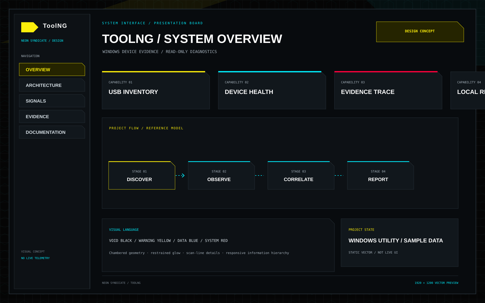

<p align="center"></p>
<h1 align="center">ToolNG</h1>
<p align="center"><strong>Windows Device Evidence Probe</strong></p>
<p align="center"></p>
<p align="center"><a href="README.md">🇺🇦 Українська</a> · <a href="README.en.md">🇬🇧 English</a> · <a href="README.ru.md">🇷🇺 Русский</a></p>
<sub>Оновлено: 2026-11-11</sub>


## NEON SYNDICATE — візуальна система

<p align="center"></p>
<p align="center"><em>Векторний макет Windows utility з SAMPLE DATA; це дизайн-концепція, а не live scan чи скриншот запущеної програми.</em></p>

[Брендбук](design/NEON_SYNDICATE.md) · [Токени дизайну](design/neon-syndicate.tokens.json)

## Поточні можливості
- Огляд доступних Windows PnP/USB-пристроїв та пов'язаних служб.
- Read-only перевірка локальних маркерів резервного копіювання.
- Спостереження за подіями підключення/відключення, локальні звіти й журнали.
- Пояснювана оцінка готовності з окремим показником повноти доказів.
- Редагування чутливих полів і рекомендації оператору.

## Швидкий старт і перевірка
```bash
cmake -S . -B build
cmake --build build --config Release
python one.py check
```

## Архітектура, межі та достовірність
ToolNG не ремонтує пристрої, не змінює драйвери чи служби, не читає приватний вміст backup і не відправляє діагностику в хмару. Рекомендація не означає виконану дію.

## Прев'ю інтерфейсу

Це статичні векторні прев'ю інтерфейсу ToolNG, а не живий знімок запущеного сканування. Усі значення пристроїв і діагностики — демонстраційні SAMPLE DATA.

<p align="center"></p>
<p align="center"><em>Оглядова панель</em></p>

<p align="center"></p>
<p align="center"><em>USB-пристрої</em></p>

<p align="center"></p>
<p align="center"><em>Локальні звіти</em></p>

## Інженерна якість
- Перевіряйте збірку й тести саме для цільової платформи; host CI не замінює hardware qualification.
- Статуси **implemented**, **partial**, **planned** мають підтверджуватися кодом, тестами та документацією.
- Не оголошуйте функцію production-ready лише на підставі макета, специфікації чи відкритого Pull Request.
- Зовнішні інтеграції мають бути явними, версіонованими, ізольованими й перевірюваними.

## Карта документації

- [Збірка та перевірка](docs/BUILDING.md)
- [Безпека й межі застосування](docs/SAFETY_AND_SCOPE.md)
- [Проєктування GUI](docs/GUI_DESIGN.md)
- [Система Duck UI](docs/DUCK_UI_SYSTEM.md)

## Ліцензія
MIT

---

## Інженерний стандарт
Індекс аудиту, тестових воріт, безпеки, супроводу та критеріїв інтеграції: [Engineering Improvement Index](docs/ENGINEERING_IMPROVEMENT_INDEX.md).

## Інтеграційні межі
Зберігайте незалежні API, runtime та цикли випуску; інтегруйте через версіоновані контракти. Практичні правила взаємодії: [Hellduck Integration Playbook](https://github.com/bboroski/Hellduck/blob/main/docs/INTEGRATION_PLAYBOOK.md).

---
**「在天愿作比翼鸟，在地愿为连理枝。」**

*«У небі — птахами-нерозлучниками, на землі — гілками одного дерева».*
