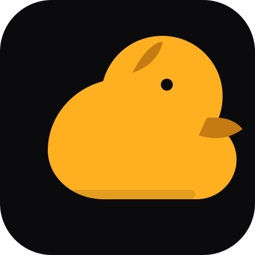

<p align="center"></p>
<h1 align="center">ToolNG</h1>
<p align="center"><strong>Windows Device Evidence Probe</strong></p>
<p align="center"><strong>Windows desktop utility · read-only диагностика</strong></p>
<p align="center"><a href="README.md">🇺🇦 Українська</a> · <a href="README.en.md">🇬🇧 English</a> · <a href="README.ru.md">🇷🇺 Русский</a></p>

> **ToolNG** — ToolNG — локальная read-only утилита диагностики Windows, отделяющая подтверждённые сигналы устройств от неизвестного состояния и неполноты проверок.

## Текущие возможности
- Наблюдение за Windows PnP/USB-устройствами и связанными службами.
- Read-only проверка локальных маркеров резервного копирования и событий подключения.
- Локальные отчёты, журналы, экспорт и редактирование чувствительных полей.
- Объяснимая оценка готовности и полноты доказательств.

## Быстрый старт и проверка
```bash
cmake -S . -B build
cmake --build build --config Release
python one.py check
```

## Архитектура и подтверждённые границы
ToolNG не ремонтирует устройства, не меняет драйверы или службы, не изучает приватное содержимое backup и не отправляет диагностику в облако. Рекомендация не означает выполненное действие.

## Инженерное качество
- Запускайте проверки для целевой платформы; host CI не заменяет аппаратную квалификацию.
- Статусы implemented, partial и planned должны подтверждаться кодом, тестами и доказательствами.
- Макет, спецификация или открытый Pull Request не доказывают production-ready реализацию.
- Внешние интеграции должны быть явными, версионированными, изолированными и тестируемыми.

## NUN Mesh и связанные репозитории

<p align="center"></p>
[SAMBU](https://github.com/bboroski/SAMBU) · [ToolNG](https://github.com/bboroski/ToolNG) · [ReaperCripple](https://github.com/bboroski/ReaperCripple) · [Kloz](https://github.com/bboroski/Kloz) · [CO](https://github.com/bboroski/CO) · [SaintSI](https://github.com/bboroski/SaintSI) · [Klipot](https://github.com/bboroski/Klipot) · [NUN](https://github.com/bboroski/NUN) · [NUNLauncher](https://github.com/bboroski/NUNLauncher) · [Fragile-Baby](https://github.com/bboroski/Fragile-Baby) · [Luci](https://github.com/bboroski/Luci)

Каждый репозиторий сохраняет каноническое имя, собственный код, API, цикл выпуска и границы ответственности. Интеграция означает версионированные контракты, а не автоматическое слияние независимых runtime.

## Дизайн и документация
Общее направление интерфейсов — **Duck Black / Yellow**: тёмные поверхности, жёлтые акценты для действий и состояний, читаемая типографика, доступный контраст, клавиатурная навигация и поддержка reduced motion. Подробности — в [design/DUCK_UI_SYSTEM.md](design/DUCK_UI_SYSTEM.md), если файл присутствует.

## Лицензия
MIT

---
**Создано с любовью к инженерии, системности и людям.**


## Палитра Duck Black / Yellow
Совместимые цвета прежних badges и marks: `#FFD600` (жёлтый) и `#111111` (почти чёрный). Текущий фон интерфейса — `#0D0D0D`. Полная палитра из шести цветов, четырнадцати функциональных оттенков и значения RGB/HSL находятся в `design/duck-ui.tokens.json` (schema 3.0.0). Жёлтый зарезервирован для основных действий, фокуса и выделения; красный и голубой обозначают семантические ошибки и информационные состояния.
